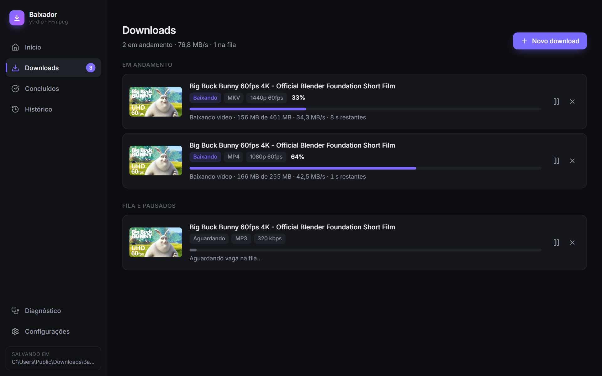

# Baixador

[Português](README.md) · **English**

A Windows desktop app for downloading video and audio with [yt-dlp](https://github.com/yt-dlp/yt-dlp) and for
converting and shrinking local videos with [FFmpeg](https://ffmpeg.org/). **The interface is in Brazilian
Portuguese only.** The Portuguese [README](README.md) is the main one and has more detail.



## Features

- Paste a link, see the real list of resolutions, frame rates and audio tracks, and download video (MP4/MKV),
  MP3 or the original audio. Playlists and albums: pick the items you want.
- Download queue with progress, pause/resume, cancel, retry and history.
- **Batch download** (paste up to 100 links at once) and a **preferred download folder**.
- **Video converter** (below).
- **In-app updates** from this repository's GitHub releases, checked only when you click.

## Requirements and install

Windows 10 or 11, 64-bit (tested on Windows 11 only). Install yt-dlp and FFmpeg (with `ffprobe.exe`)
yourself; recent yt-dlp also needs a JavaScript runtime such as Deno for YouTube
([wiki](https://github.com/yt-dlp/yt-dlp/wiki/EJS)). Neither program is bundled.

```powershell
winget install yt-dlp.yt-dlp
winget install Gyan.FFmpeg
winget install DenoLand.Deno
```

Download the installer or the portable zip from [Releases](../../releases). The files are not code-signed, so
Windows SmartScreen will warn you.

## Video converter

Open **Conversor**, drop a video, pick a preset and click **Converter**. The source file is never modified and
existing files are never overwritten.

| Group | Presets |
|---|---|
| Sharing | WhatsApp (up to 180 MB), Discord (optional size limit), Social media |
| Quality | Balanced, High quality, Smaller file |
| Compatibility | Universal MP4, Maximum compatibility (up to 720p30, H.264 Main 3.1) |
| Resolution / FPS | Original, 2160p60, 1440p60, 1080p60/30/24, 720p60/30/24, 480p30 |
| Tools | Change container without re-encoding, Extract MP3, WebM (VP9 + Opus) |

"1080p" means the shorter side, so portrait videos work too. By default nothing is upscaled and the frame rate
is never raised. **Custom mode** sets container (MP4, MKV, WebM, MP3), codec (H.264, H.265, AV1, VP9, only
those that pass a test on your PC), encoder, resolution, FPS, quality, bitrate or maximum size, audio and
metadata. Incompatible combinations are rejected.

### The WhatsApp size target

- The ceiling is **180,000,000 bytes**. It is a Baixador setting; other services' upload limits can change.
- 5% is kept as margin, audio (AAC, 128 kbps, less for long videos) is subtracted, and the rest divided by the
  duration gives the video bitrate.
- Short videos are not inflated to fill the limit.
- If the bitrate is too low for the source resolution, the resolution is lowered. If quality would still be
  unacceptable, nothing is converted and the app offers 360p or a larger limit.
- CPU encodes use two passes; NVENC uses VBR with multipass. If the result is too large it is encoded again at
  a lower bitrate, at most 3 attempts, and the app tells you if it is still over.
- Strong compression **loses quality**, especially in busy scenes.

### CPU vs NVIDIA NVENC

CPU (libx264) works everywhere. NVENC is much faster and needs an NVIDIA GPU with NVENC, a driver recent enough
for your FFmpeg build, and an FFmpeg that includes NVENC. **Detectar aceleração GPU** runs a short real encode;
being listed by FFmpeg is not enough. The GPU is used only if you enable it. If a GPU encode fails, the app
offers a CPU retry and never restarts on its own. NVENC H.264 does not accept pictures wider than 4096 px.
Nothing is installed automatically.

On one test PC (RTX 5060 Ti), a 40 s 4K60 clip (231 MB) became 168 MB in 93 s on the CPU and 162 MB in 29 s on
the GPU. Your results will differ.

### Limitations and compatibility

HDR is converted to SDR (colours may differ). Subtitles and data tracks are dropped and only the first audio
track is kept. One conversion at a time. Size estimates are ranges, not promises. MP4 + H.264 + AAC plays
almost everywhere; H.265 and AV1 are smaller but not supported by every device; some apps and TVs reject MKV
and WebM.

## Updates

**Configurações → Sobre e atualizações → Atualizar app.** One click checks, downloads, verifies, installs and
reopens the app (from 1.4.0 on; **Só verificar** shows the release notes first). Only the latest stable release
is considered (no drafts, pre-releases, same or older versions). The download is checked against the release's
`SHA256SUMS.txt` (and its size, when announced). If the GitHub API request limit is hit, the public releases
page is used instead, without release notes. The installed version runs the new installer silently and restarts. The portable version swaps its folder after the app closes and keeps the old
one as `<folder>.anterior-<version>`; if the folder contains files that aren't part of the app, the swap is
refused. Version 1.0.0 has no updater, so install the latest version manually once.

## Build

Node.js and npm (tested with Node 26 / npm 11): `npm ci`, then `npm run dev`, `npm start` or `npm run dist`.
Tests: `npm run test:updater` (add `-- --real` to test against GitHub) and `npm run test:convert -- <folder>`
(see [tests/README.md](tests/README.md)).

## Code signing policy

**Baixador binaries are not code-signed yet**, and the project has not been accepted by any signing program.
See the [**Code signing policy**](CODE_SIGNING_POLICY.md).

## Privacy, terms and licenses

No account, telemetry or server of ours. [Privacy policy](PRIVACY.md) and [Terms](TERMS.md) (in Portuguese),
[content and trademarks](CONTENT_NOTICE.md), [security](SECURITY.md),
[third-party notices](THIRD_PARTY_NOTICES.md). Baixador is not affiliated with YouTube, WhatsApp, Discord,
NVIDIA or any other service it mentions. Only download and convert content you have the right to use.

Licensed under [MIT](LICENSE). Most of the code and documentation was written by Claude (Anthropic) under the
repository owner's direction.
