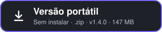
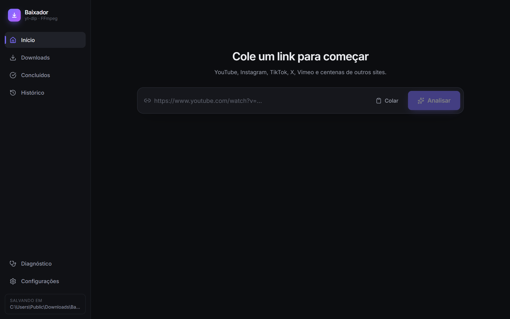
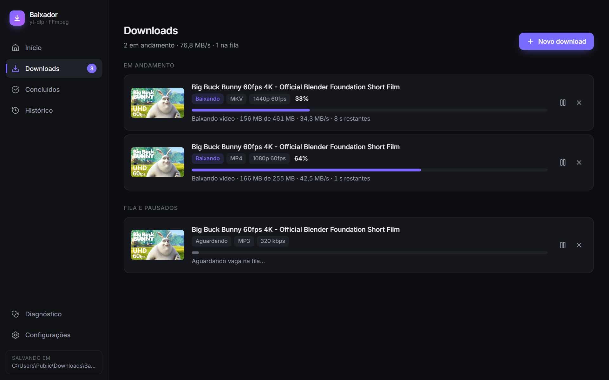
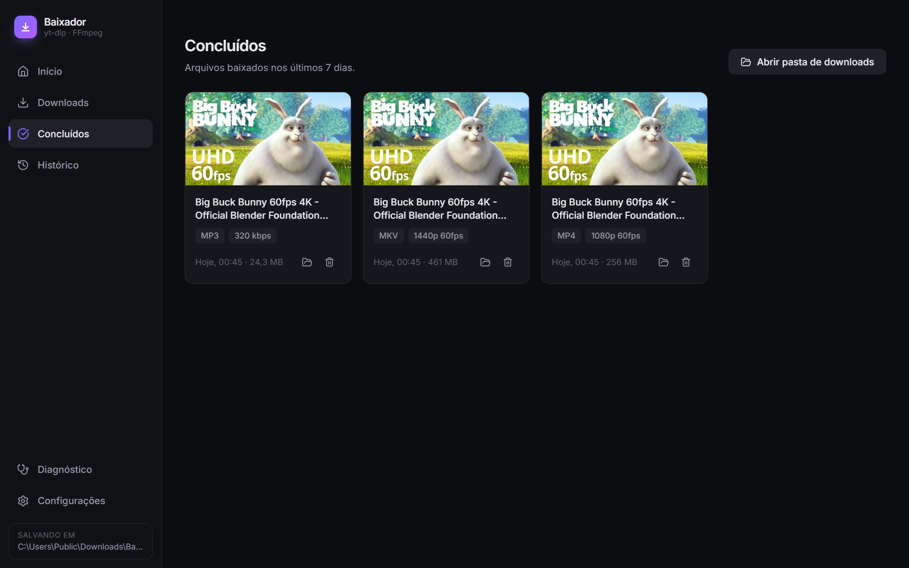
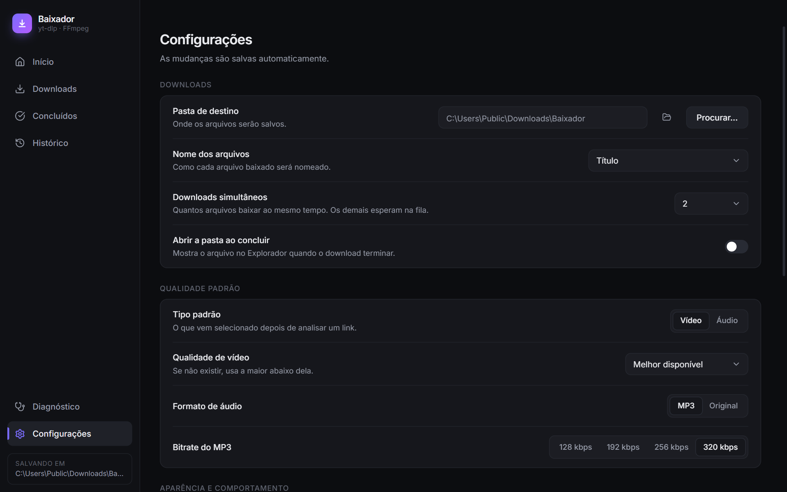

<p align="center">
  
</p>

# Baixador

<p align="center">
  <a href="https://github.com/odavyyy/baixador/releases/download/v1.1.0/Baixador-Setup-1.1.0.exe"></a>
  &nbsp;&nbsp;
  <a href="https://github.com/odavyyy/baixador/releases/download/v1.1.0/Baixador-1.1.0-win-x64.zip"></a>
</p>

<p align="center">
  Windows 10 ou 11 (testado no 11) · precisa do <a href="#requisitos">yt-dlp e do FFmpeg</a> · sem assinatura digital (<a href="#instalação">veja como instalar</a>) ·
  <a href="../../releases/latest">todas as versões</a>
</p>

O Baixador é um app para Windows que baixa vídeo e áudio com o
[yt-dlp](https://github.com/yt-dlp/yt-dlp) e o [FFmpeg](https://ffmpeg.org/). Você cola um link, vê as
qualidades que existem de verdade, escolhe uma e baixa, sem digitar nenhum comando.

Os programas yt-dlp e FFmpeg não vêm junto com o app. Ele usa as cópias que você já tem instaladas, e
nada passa por um servidor nosso. (Veja [O que acessa a internet](#o-que-acessa-a-internet).)

## Funcionalidades

- **Análise real do link.** Executa `yt-dlp -J` e mostra título, canal, duração, capa e todas as
  resoluções e taxas de quadros que o site oferece, com o tamanho estimado quando o yt-dlp informa.
- **Vídeo**
  - **MP4:** prioriza H.264, para o arquivo abrir em qualquer player. Acima de 1080p, alguns sites só
    oferecem VP9/AV1.
  - **MKV:** o melhor vídeo e áudio exatamente como o site entrega, sem conversão.
- **Áudio**
  - **MP3:** 128, 192, 256 ou 320 kbps, convertido pelo FFmpeg, com capa, título e artista gravados no arquivo.
  - **Áudio original:** sem conversão (por exemplo, AAC `.m4a` ou Opus), escolhido entre as faixas que o
    yt-dlp lista.
- **Gerenciador de downloads**
  - Fila com número configurável de downloads simultâneos.
  - Progresso, velocidade, tempo restante e tamanho reais, lidos da saída do yt-dlp.
  - Pausar e continuar (o yt-dlp retoma o arquivo `.part`), cancelar (os arquivos parciais são apagados),
    tentar de novo, abrir o arquivo ou mostrar na pasta.
- **Histórico e downloads recentes**
  - Busca, filtro por vídeo ou áudio e capa salva no computador para cada download.
  - Remover um item não apaga o arquivo. É preciso marcar uma opção e confirmar, e mesmo assim ele vai
    para a Lixeira.
- **Playlists e álbuns.** Cole o link da playlist, veja a lista, marque o que quiser e escolha áudio (MP3 ou
  original) ou vídeo (MP4 ou MKV). Cada item entra na fila, com progresso e opção de tentar de novo, e pode
  ser salvo em uma pasta com o nome da playlist. Em um link de vídeo que também faz parte de uma playlist,
  o app oferece ver a playlist inteira. Em playlists, a qualidade de vídeo é um limite ("até 1080p"),
  porque cada vídeo não é analisado antes.
- **Detecção de links copiados.** Copie um link em qualquer lugar e o app oferece colar.
- **Configurações**
  - Pasta de destino (com o seletor do Windows), qualidade, formato e bitrate padrão, nome dos arquivos,
    abrir a pasta ao concluir, downloads simultâneos e tema escuro, claro ou do sistema.
  - Notificações do Windows e uso opcional dos cookies do navegador, para vídeos com restrição de idade
    ou que exigem login.
- **Diagnóstico.** Versões das ferramentas, botão **Atualizar yt-dlp** (`yt-dlp -U`) e registro técnico
  completo, que pode ser copiado ou exportado. No uso comum, aparecem apenas mensagens de erro curtas e
  claras. O botão **Detectar** fica em **Configurações → Programas**.

## Capturas de tela

| Cole um link | Escolha a qualidade |
|---|---|
|  |  |
| **Bitrate do MP3** | **Downloads em andamento** |
|  |  |
| **Concluídos** | **Configurações** |
|  |  |

Todas as capturas foram feitas no app em funcionamento, durante downloads reais. O vídeo que aparece é
*Big Buck Bunny* (veja os [Créditos](#créditos)). O aviso amarelo em duas delas é o aviso real do app de
que o yt-dlp instalado estava desatualizado naquele momento.

## Requisitos

- **Windows 10 ou 11, 64 bits.** Testado apenas no Windows 11 x64.
- **yt-dlp:** <https://github.com/yt-dlp/yt-dlp#installation>
- **FFmpeg** (com o ffprobe): <https://ffmpeg.org/download.html>
- Para o YouTube, as versões recentes do yt-dlp também precisam de um runtime JavaScript, como o Deno.
  Veja a wiki do yt-dlp: <https://github.com/yt-dlp/yt-dlp/wiki/EJS>

Uma forma de instalar os três é pelo winget:

```powershell
winget install yt-dlp.yt-dlp
winget install Gyan.FFmpeg
winget install DenoLand.Deno
```

## Instalação

1. Baixe o `Baixador-Setup-1.1.0.exe` na página de [Releases](../../releases) e execute.
   Há também a versão portátil, `Baixador-1.1.0-win-x64.zip`: extraia em qualquer pasta e abra o
   `Baixador.exe`.
2. Abra o **Baixador**. Na primeira vez, ele procura o yt-dlp e o FFmpeg (veja abaixo). Se não
   encontrar, a tela inicial avisa, e você pode indicar os caminhos em **Configurações → Programas**.

O instalador e o executável **não têm assinatura digital**, então o Windows SmartScreen provavelmente
vai mostrar um aviso. Se você confia no arquivo, clique em *Mais informações → Executar assim mesmo*.
Você também pode compilar a partir do código-fonte.

### Onde o app procura o yt-dlp e o FFmpeg

Na primeira execução, e sempre que um caminho configurado deixa de existir, ele procura nesta ordem:

1. `C:\yt-dlp\yt-dlp.exe` e `C:\ffmpeg\bin\ffmpeg.exe` (ou `C:\Program Files\ffmpeg\bin\ffmpeg.exe`)
2. Atalhos do winget: `%LOCALAPPDATA%\Microsoft\WinGet\Links`
3. Atalhos do Scoop: `%USERPROFILE%\scoop\shims`
4. Chocolatey: `%ProgramData%\chocolatey\bin`
5. Qualquer um que esteja no `PATH` (`where yt-dlp.exe`)

Nenhum desses caminhos é obrigatório. Nas configurações, você pode apontar para qualquer `yt-dlp.exe` e
`ffmpeg.exe`. A pasta do FFmpeg é enviada ao yt-dlp com `--ffmpeg-location`, por isso o `ffprobe.exe`
precisa estar ao lado do `ffmpeg.exe`.

A pasta de downloads padrão é `C:\yt-dlp\Downloads` se `C:\yt-dlp` existir. Caso contrário, é
`Downloads\Baixador` na sua pasta de usuário.

## Compilar a partir do código-fonte

Você precisa do [Node.js](https://nodejs.org/) e do npm. O projeto foi desenvolvido e testado com Node 26
e npm 11. Versões mais antigas podem funcionar, mas não foram testadas.

```powershell
git clone https://github.com/odavyyy/baixador.git
cd baixador
npm ci
```

| Comando | O que faz |
|---|---|
| `npm run dev` | Modo desenvolvimento: servidor do Vite com recarga automática da interface, mais o Electron. Reinicie após alterar `src/main`. |
| `npm start` | Verifica os tipos, compila e abre o app. |
| `npm run build` | Apenas verifica os tipos e compila para `dist/`. |
| `npm run dist` | Gera o instalador e o zip portátil para Windows em `release/`. |
| `npm run notices` | Gera novamente o `THIRD_PARTY_NOTICES.md` a partir das licenças dos pacotes instalados. |
| `npm run art` | Gera novamente o `build/icon.png` e o `docs/banner.png`. |

Observações:

- O Electron é baixado automaticamente na primeira vez que você roda `npm run dev` ou `npm start`. Se
  falhar, apague `node_modules/electron` e rode `npx install-electron`.
- O npm 11 pede autorização para rodar scripts de instalação. Os dois necessários (`esbuild` e
  `electron-winstaller`) já estão liberados em `allowScripts`, no `package.json`.
- O `npm run dist` usa o NSIS, que não aceita caminhos muito longos. Se aparecer
  `!include: could not open file ... .nsh`, compile em uma pasta com caminho mais curto, como
  `C:\src\baixador`.
- O `npm audit` aponta problemas de gravidade moderada em dependências do electron-builder (ferramenta de
  compilação, que não vai dentro do app).
- O `build/icon.ico` foi montado a partir do `build/icon.png`, nos tamanhos de 16 a 256 px. Se trocar o
  ícone, use qualquer ferramenta que gere um `.ico` com vários tamanhos.

### Testar com uma pasta de dados separada

Defina `BAIXADOR_DATA_DIR` para não misturar as configurações e o histórico de teste com os normais:

```powershell
$env:BAIXADOR_DATA_DIR = "$env:TEMP\baixador-test"; npm start
```

## Estrutura do projeto

```
src/
  main/                 processo principal do Electron (Node.js)
    main.ts             janela, IPC, área de transferência, notificações, histórico
    ytdlp.ts            análise (yt-dlp -J), leitura dos formatos, mensagens de erro, detecção das ferramentas
    downloads.ts        fila, progresso, pausar/continuar/cancelar/tentar de novo, alternativa HLS
    store.ts            armazenamento em JSON em %APPDATA%\Baixador
    logger.ts           registro técnico (tela Diagnóstico e arquivo de log diário)
    preload.ts          API disponível para a interface (contextIsolation, sandbox)
  renderer/             interface em React (Vite + Tailwind CSS)
    src/pages/          Início, Downloads, Concluídos, Histórico, Configurações, Diagnóstico
    src/components/     componentes visuais
  shared/types.ts       tipos usados pelos dois lados
scripts/                modo desenvolvimento, empacotador do processo principal, arte e avisos de licença
build/                  ícone do app (SVG, PNG e ICO)
docs/                   capturas de tela, banner e o HTML que o gera
```

A interface só conversa com o processo principal pela API do preload. Configurações, histórico e fila são
arquivos JSON em `%APPDATA%\Baixador`. As capas ficam na pasta `thumbs`, e os logs em
`logs\baixador-AAAA-MM-DD.log`.

## O que acessa a internet

- O **yt-dlp** acessa o site do link que você cola, para analisar e baixar, como faria pela linha de comando.
- As **capas** são carregadas do servidor de imagens do site, para a prévia, e salvas no computador para o
  histórico.
- **Atualizar yt-dlp** (em Diagnóstico) executa `yt-dlp -U`, que baixa a versão oficial. Isso só acontece
  quando você clica.
- **Cookies do navegador** (desativado por padrão) permite que o yt-dlp leia os cookies do seu navegador
  para aquele site.

É só isso. Não há telemetria, conta, atualização automática nem servidor nosso.

## Problemas comuns

| Problema | O que tentar |
|---|---|
| "yt-dlp não foi encontrado" ou "FFmpeg não foi encontrado" | Instale (veja os Requisitos) e vá em **Configurações → Programas → Detectar**, ou escolha o `.exe`. |
| YouTube: erro 403, formatos faltando ou o aviso amarelo "pode estar desatualizado" | Atualize o yt-dlp (**Diagnóstico → Atualizar yt-dlp**) e confira se há um runtime JavaScript instalado ([wiki EJS](https://github.com/yt-dlp/yt-dlp/wiki/EJS)). Após um erro 403, o app tenta mais uma vez usando HLS. |
| "Sign in to confirm you're not a bot" ou restrição de idade | **Configurações → Avançado → Usar cookies do navegador**, com um navegador em que você esteja logado. Navegadores baseados no Chromium costumam bloquear o banco de cookies enquanto estão abertos. O Firefox geralmente é mais fácil. |
| O arquivo baixado tem "(720p 60fps)" no nome | Já existia um arquivo com o nome simples (por exemplo, em outra qualidade). O app não sobrescreve. |
| O MP4 não abre | Acima de 1080p, os sites muitas vezes só oferecem VP9/AV1. Escolha 1080p ou menos para ter H.264, ou use um player como VLC ou mpv. |
| O link abre só um vídeo, e não a playlist | Clique em **Ver playlist inteira**, que aparece quando o link também traz a playlist. Mixes automáticos do YouTube não são suportados, porque não têm fim. |
| Transmissões ao vivo | Ainda não são suportadas. O app avisa e não inicia o download. |
| Outro problema | A tela **Diagnóstico** mostra a saída completa do yt-dlp, que você pode exportar ao abrir uma issue. |

## Testes e situação atual

Versão 1.1.0. Testado no Windows 11 Pro x64, com o yt-dlp 2026.10.26 e uma versão do FFmpeg de novembro de 2026:

- Análise de links e lista de formatos no YouTube.
- Um álbum do YouTube Music com 14 faixas, baixado inteiro em MP3 (VBR máxima), com dois downloads por vez,
  inclusive títulos com acento. Em uma das faixas houve erro 403, e a nova tentativa via HLS funcionou.
- MP4 (240p, 720p60 e 1080p60), MKV (240p AV1 e 1440p60), MP3 (128, 192 e 320 kbps com capa) e M4A original.
- Dois downloads simultâneos com um na fila; pausar e continuar, cancelar com limpeza e tentar de novo.
- Mensagem de erro clara para um link que não é de vídeo, e remoção de um item do histórico sem apagar o arquivo.
- Detecção automática do yt-dlp e do FFmpeg (na abertura e pelo botão **Detectar**) e o aviso de ferramenta ausente.
- A versão portátil (extraída e executada) e o app descompactado; `npm ci` do zero, seguido de
  `npm run dev`, `npm run build` e `npm run dist`.

Ainda não testado: outros sites (Instagram, TikTok etc.), Windows 10, o instalador e o desinstalador,
a opção de cookies do navegador, a detecção de links copiados, as
notificações do Windows, o botão **Atualizar yt-dlp**, apagar um arquivo para a Lixeira pelo Histórico,
padrões de nome diferentes de "Título", abrir a pasta ao concluir e a exportação do log.

## Como foi feito

O Baixador foi desenvolvido com grande ajuda de IA: a maior parte do código, da documentação e da arte
foi escrita pelo [Claude](https://www.anthropic.com/claude) (Anthropic), a partir dos requisitos
definidos pelo dono do repositório. O que foi ou não verificado está em
[Testes e situação atual](#testes-e-situação-atual).

## Use com responsabilidade

O Baixador é uma interface para o yt-dlp. Baixe apenas o que você tem direito de baixar e respeite os
direitos autorais e os termos dos sites que usar.

## Licença

[MIT](LICENSE). É curta, permissiva e muito usada em ferramentas pequenas como esta. Qualquer pessoa pode
usar, modificar e compartilhar o código, desde que mantenha o aviso de copyright. O texto da licença está
em inglês porque essa é a versão padrão.

## Créditos

- [yt-dlp](https://github.com/yt-dlp/yt-dlp) (Unlicense) e [FFmpeg](https://ffmpeg.org/) (LGPL/GPL).
  São eles que fazem o trabalho principal, e seus programas (`yt-dlp.exe`, `ffmpeg.exe` e `ffprobe.exe`)
  **não** são redistribuídos com este app. (O Electron inclui o próprio `ffmpeg.dll`, a biblioteca de
  mídia LGPL do Chromium. O Baixador não a usa, e ela está coberta pelos avisos do Electron.)
- Incluídos no app: [Electron](https://www.electronjs.org/) (MIT, com o Chromium; os avisos ficam em
  `LICENSES.chromium.html`, ao lado do `Baixador.exe`), [React](https://react.dev/) (MIT), ícones
  [Lucide](https://lucide.dev/) (ISC) e a fonte [Inter](https://rsms.me/inter/) (SIL Open Font License 1.1).
  Os textos completos estão em [THIRD_PARTY_NOTICES.md](THIRD_PARTY_NOTICES.md).
- Ferramentas de compilação: Vite, Tailwind CSS, TypeScript, esbuild e electron-builder.
- O vídeo das capturas e do banner é *Big Buck Bunny*, © 2008 Blender Foundation |
  [peach.blender.org](https://peach.blender.org/), sob a licença
  [CC BY 3.0](https://creativecommons.org/licenses/by/3.0/deed.pt-br).
