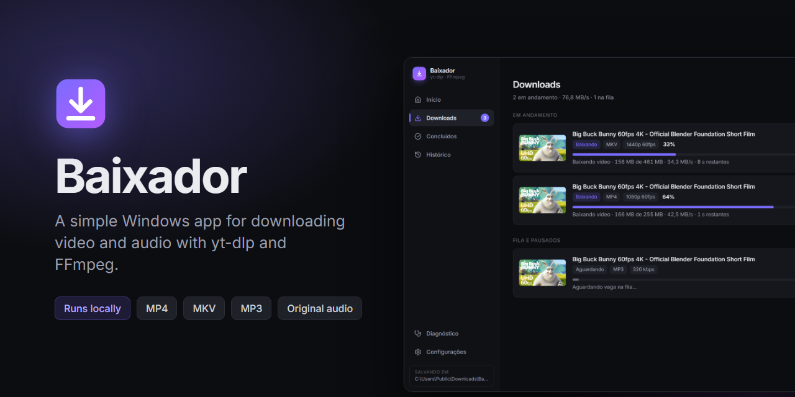
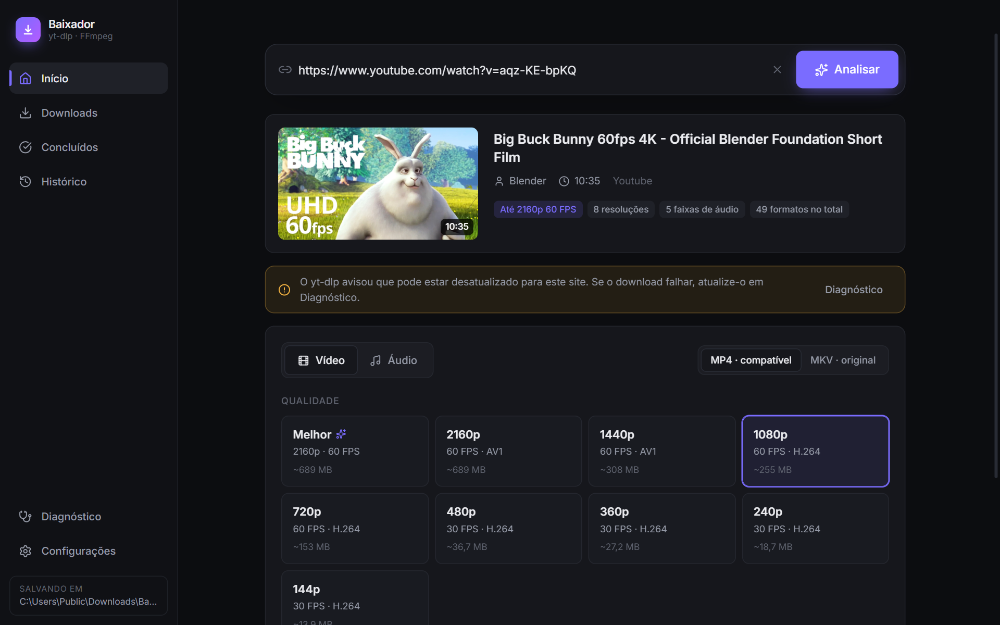
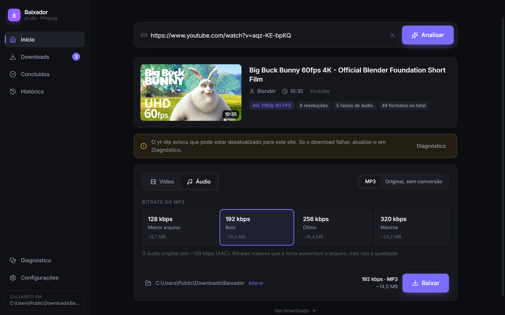

<p align="center">
  
</p>

# Baixador

Baixador is a Windows desktop app for downloading video and audio with
[yt-dlp](https://github.com/yt-dlp/yt-dlp) and [FFmpeg](https://ffmpeg.org/). You paste a link, see
the qualities that are actually available, pick one and download. You never type a command.

It doesn't bundle the yt-dlp or FFmpeg programs. It drives the copies you already have installed, and nothing goes
through a server of ours. (See [What goes online](#what-goes-online).)

> **Language:** the interface is currently in **Brazilian Portuguese** only. This README is in English;
> a Portuguese version is in [README.pt-BR.md](README.pt-BR.md).

## Features

- **Real link analysis.** Runs `yt-dlp -J`, then shows the title, channel, duration, thumbnail and every
  resolution / frame rate the site offers, with estimated file sizes when yt-dlp reports them.
- **Video**
  - **MP4:** prefers H.264 so the file plays everywhere; above 1080p some sites only offer VP9/AV1.
  - **MKV:** the best streams exactly as the site serves them, no re-encoding.
- **Audio**
  - **MP3:** 128, 192, 256 or 320 kbps, converted by FFmpeg, with the cover art and title/artist tags embedded.
  - **Original audio:** no conversion (e.g. AAC `.m4a` or Opus), picked from the tracks yt-dlp lists.
- **Download manager**
  - A queue with a configurable number of parallel downloads.
  - Real progress, speed, ETA and size, parsed from yt-dlp's output.
  - Pause/resume (yt-dlp continues the `.part` file), cancel (partial files are cleaned up), retry,
    open the file, show it in its folder.
- **History and recent downloads**
  - Search and a video/audio filter, with a locally cached thumbnail per download.
  - Removing an entry never deletes the file. You have to tick a box and confirm, and even then the file
    goes to the Recycle Bin.
- **Clipboard detection.** Copy a link anywhere and the app offers to paste it.
- **Settings**
  - Download folder (native folder picker), default quality / format / bitrate, file-name pattern,
    "open folder when done", parallel downloads, dark/light/system theme.
  - Windows notifications, plus optional cookies from your browser for age-restricted or login-only videos.
- **Diagnostics.** Tool versions, a "Detect" button for the yt-dlp/FFmpeg paths, an "Update yt-dlp"
  button (`yt-dlp -U`), and the full technical log (copy / export). Users see short, friendly error
  messages; the raw output stays here.

## Screenshots

| Paste a link | Pick a quality |
|---|---|
|  |  |
| **MP3 bitrate** | **Downloads in progress** |
|  |  |
| **Recently completed** | **Settings** |
|  |  |

All screenshots were taken from the running app during real downloads. The video shown is
*Big Buck Bunny* (see [Credits](#credits)). The yellow notice in two of them is the app's real warning
that the installed yt-dlp was out of date at the time.

## Requirements

- **Windows 10 or 11, 64-bit.** Only tested on Windows 11 x64.
- **yt-dlp** — <https://github.com/yt-dlp/yt-dlp#installation>
- **FFmpeg** (with ffprobe) — <https://ffmpeg.org/download.html>
- For YouTube, recent yt-dlp versions also need a JavaScript runtime such as Deno.
  See the yt-dlp wiki: <https://github.com/yt-dlp/yt-dlp/wiki/EJS>

One way to install all three is winget:

```powershell
winget install yt-dlp.yt-dlp
winget install Gyan.FFmpeg
winget install DenoLand.Deno
```

## Install

1. Download `Baixador-Setup-1.0.0.exe` from the [Releases](../../releases) page and run it.
   There is also a portable `Baixador-1.0.0-win-x64.zip`: extract it anywhere and run `Baixador.exe`.
2. Open **Baixador**. On first start it looks for yt-dlp and FFmpeg (see below). If it can't find them,
   the home screen tells you, and you can set the paths in **Configurações → Programas**.

The installer and the executable are **not code-signed**, so Windows SmartScreen will probably warn you.
Click *More info → Run anyway* if you trust the build, or build it yourself from source.

### Where the app looks for yt-dlp and FFmpeg

On first start, and whenever a configured path stops existing, it checks in this order:

1. `C:\yt-dlp\yt-dlp.exe` and `C:\ffmpeg\bin\ffmpeg.exe` (or `C:\Program Files\ffmpeg\bin\ffmpeg.exe`)
2. winget links: `%LOCALAPPDATA%\Microsoft\WinGet\Links`
3. Scoop shims: `%USERPROFILE%\scoop\shims`
4. Chocolatey: `%ProgramData%\chocolatey\bin`
5. Anything on your `PATH` (`where yt-dlp.exe`)

None of these paths is required. You can point the app at any `yt-dlp.exe` / `ffmpeg.exe` in
Settings. FFmpeg's folder is passed to yt-dlp with `--ffmpeg-location`, so `ffprobe.exe` must be next to
`ffmpeg.exe`.

The default download folder is `C:\yt-dlp\Downloads` if `C:\yt-dlp` exists, otherwise
`Downloads\Baixador` in your user folder.

## Build from source

You need [Node.js](https://nodejs.org/) and npm. It was developed and tested with Node 26 and npm 11;
older versions may work but haven't been tried.

```powershell
git clone https://github.com/odavyyy/baixador.git
cd baixador
npm ci
```

| Command | What it does |
|---|---|
| `npm run dev` | Vite dev server with hot reload for the UI, plus Electron. Restart it after changing `src/main`. |
| `npm start` | Type-check, build, and run the app. |
| `npm run build` | Type-check and build into `dist/` only. |
| `npm run dist` | Build the Windows installer and the portable zip into `release/`. |
| `npm run notices` | Regenerate `THIRD_PARTY_NOTICES.md` from the installed packages' license files. |
| `npm run art` | Re-render `build/icon.png` and `docs/banner.png` from their sources. |

Notes:

- The Electron binary is downloaded automatically the first time you run `npm run dev` or `npm start`.
  If that fails, delete `node_modules/electron` and run `npx install-electron`.
- npm 11 asks before running install scripts. The two the build needs (`esbuild` and
  `electron-winstaller`) are already approved in `package.json` → `allowScripts`.
- `npm run dist` uses NSIS, which can't handle very long paths. If you see
  `!include: could not open file ... .nsh`, build from a shorter folder such as `C:\src\baixador`.
- `npm audit` currently reports moderate issues in electron-builder's own dependencies (build tooling,
  not shipped in the app).
- `build/icon.ico` was assembled from `build/icon.png` at 16–256 px. Any tool that writes multi-size
  `.ico` files works if you change the icon.

### Testing with a separate data folder

Set `BAIXADOR_DATA_DIR` to keep test settings and history away from your normal ones:

```powershell
$env:BAIXADOR_DATA_DIR = "$env:TEMP\baixador-test"; npm start
```

## Project structure

```
src/
  main/                 Electron main process (Node.js)
    main.ts             window, IPC handlers, clipboard watcher, notifications, history
    ytdlp.ts            link analysis (yt-dlp -J), format parsing, friendly errors, tool detection
    downloads.ts        queue, progress parsing, pause/resume/cancel/retry, HLS fallback
    store.ts            JSON storage in %APPDATA%\Baixador
    logger.ts           technical log (Diagnóstico page + daily log file)
    preload.ts          the API exposed to the UI (contextIsolation, sandbox)
  renderer/             React UI (Vite + Tailwind CSS)
    src/pages/          Início, Downloads, Concluídos, Histórico, Configurações, Diagnóstico
    src/components/     small UI kit
  shared/types.ts       types shared by both sides
scripts/                dev runner, main-process bundler, artwork renderer, notices generator
build/                  app icon (SVG source, PNG, ICO)
docs/                   screenshots, banner and its HTML source
```

The UI talks to the main process only through the preload API. Settings, history and the download
queue are plain JSON files in `%APPDATA%\Baixador`, thumbnails are cached in its `thumbs` folder, and
logs go to `logs\baixador-YYYY-MM-DD.log`.

## What goes online

- **yt-dlp** contacts the site whose link you paste, for analysis and download, as it does from the
  command line.
- **Thumbnails** are loaded from the site's image server for the preview and cached locally for the
  history.
- **Update yt-dlp** (Diagnostics) runs `yt-dlp -U`, which downloads the official release. It only runs
  when you click it.
- **Cookies from browser** (off by default) lets yt-dlp read your browser's cookies for that site.

That's all. There is no telemetry, no account, no auto-update and no server of ours involved.

## Troubleshooting

| Problem | What to try |
|---|---|
| "yt-dlp não foi encontrado" / "FFmpeg não foi encontrado" | Install it (see Requirements), then **Configurações → Programas → Detectar**, or browse to the `.exe`. |
| YouTube: HTTP 403, missing formats, or the yellow "pode estar desatualizado" notice | Update yt-dlp (**Diagnóstico → Atualizar yt-dlp**) and make sure a JavaScript runtime is installed ([EJS wiki](https://github.com/yt-dlp/yt-dlp/wiki/EJS)). After a 403 the app retries once using HLS streams. That code path exists but was not triggered in testing. |
| "Sign in to confirm you're not a bot" / age-restricted | **Configurações → Avançado → Usar cookies do navegador**, with a browser where you're logged in. Chromium browsers often lock their cookie database while open; Firefox is usually easier. |
| A downloaded file has "(720p 60fps)" in its name | A file with the plain name already existed (e.g. another quality). The app never overwrites. |
| The MP4 won't play | Above 1080p, sites often only offer VP9/AV1. Pick 1080p or lower for H.264, or use a player like VLC/mpv. |
| Playlists or live streams | Not supported yet; the app tells you and doesn't start a download. |
| Something else | **Diagnóstico** shows the full yt-dlp output; you can export it when opening an issue. |

## Status and testing

Version 1.0.0. Tested on Windows 11 Pro x64 with yt-dlp 2026.10.26 and an FFmpeg 2026-11 build:

- Link analysis and the format list on YouTube.
- MP4 (240p, 720p60, 1080p60), MKV (240p AV1, 1440p60), MP3 (128/192/320 kbps with cover art),
  original M4A.
- Two downloads in parallel plus a queued one; pause/resume, cancel with cleanup, retry.
- Friendly error for a non-video link, and removing a history entry without deleting the file.
- Automatic detection of yt-dlp/FFmpeg (startup and the "Detect" button), the missing-tool notice.
- The portable build (extracted and run) and the unpacked app; a clean `npm ci` → `npm run dev` /
  `npm run build` / `npm run dist`.

Not tested yet: other sites (Instagram, TikTok, etc.), Windows 10, running the NSIS installer and
uninstaller, the browser-cookies option, the HLS fallback after a 403, clipboard link detection,
Windows notifications, the "Update yt-dlp" button, deleting a file to the Recycle Bin from History,
file-name patterns other than "Título", "open folder when done", and log export.

## How it was made

Baixador was developed with substantial help from AI: most of the code, documentation and artwork was
written by [Claude](https://www.anthropic.com/claude) (Anthropic), based on requirements set by the
repository owner. What was and wasn't verified is listed under [Status and testing](#status-and-testing).

## Please use it responsibly

Baixador is a front end for yt-dlp. Only download content you have the right to download, and respect
copyright and the terms of the sites you use.

## License

[MIT](LICENSE). It's short, permissive and the most common choice for small desktop tools. Anyone can
use, change and share the code, as long as the copyright notice stays.

## Credits

- [yt-dlp](https://github.com/yt-dlp/yt-dlp) (Unlicense) and [FFmpeg](https://ffmpeg.org/)
  (LGPL/GPL). They do the real work, and their programs (`yt-dlp.exe`, `ffmpeg.exe`, `ffprobe.exe`) are
  **not** redistributed with this app. (Electron includes its own `ffmpeg.dll`, Chromium's LGPL media
  library. Baixador doesn't use it, and it's covered by Electron's notices.)
- Shipped inside the app: [Electron](https://www.electronjs.org/) (MIT, includes Chromium; its notices
  are in `LICENSES.chromium.html` next to `Baixador.exe`), [React](https://react.dev/) (MIT),
  [Lucide](https://lucide.dev/) icons (ISC), and the [Inter](https://rsms.me/inter/) typeface (SIL Open Font
  License 1.1). Full license texts: [THIRD_PARTY_NOTICES.md](THIRD_PARTY_NOTICES.md).
- Build tools: Vite, Tailwind CSS, TypeScript, esbuild, electron-builder.
- The video in the screenshots and banner is *Big Buck Bunny*, © 2008 Blender Foundation |
  [peach.blender.org](https://peach.blender.org/), licensed
  [CC BY 3.0](https://creativecommons.org/licenses/by/3.0/).
