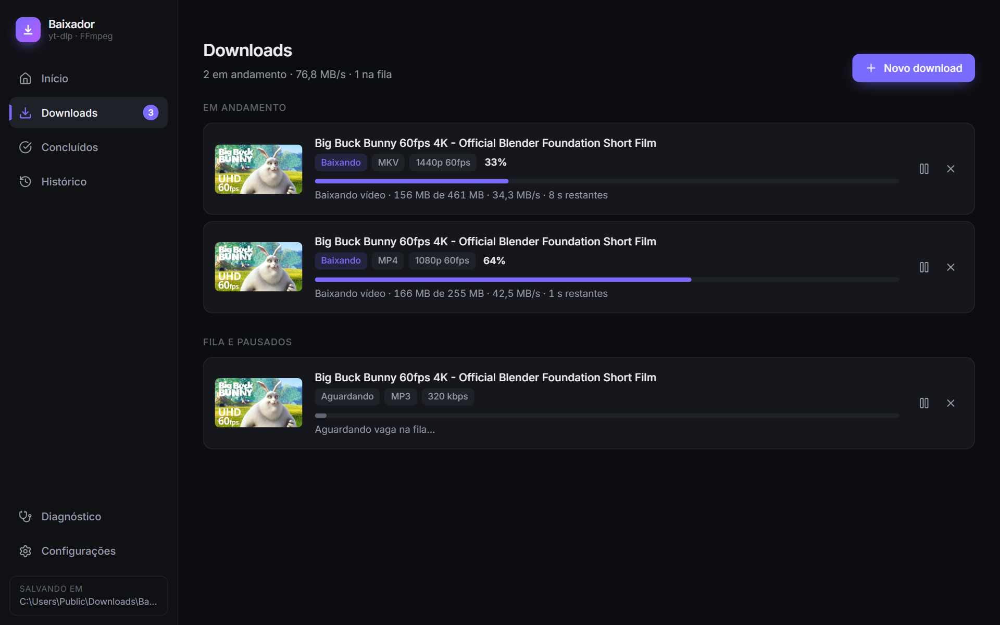

# Baixador

[English](README.md) · **Português**

O Baixador é um app para Windows que baixa vídeo e áudio usando o [yt-dlp](https://github.com/yt-dlp/yt-dlp) e
o [FFmpeg](https://ffmpeg.org/) que você já tem instalados. Você cola o link, vê as qualidades que
existem de verdade, escolhe uma e baixa, sem abrir o terminal.

O yt-dlp e o FFmpeg não vêm junto com o app. Ele usa as suas cópias. Nenhum link nem arquivo passa por
servidores nossos. Os detalhes estão em "O que acessa a internet", no [README em inglês](README.md#what-goes-online).



## O que você precisa

- Windows 10 ou 11, 64 bits (testado só no Windows 11).
- yt-dlp, FFmpeg (com ffprobe) e, para o YouTube, um runtime JavaScript como o Deno
  ([wiki do yt-dlp](https://github.com/yt-dlp/yt-dlp/wiki/EJS)). Pelo winget:

```powershell
winget install yt-dlp.yt-dlp
winget install Gyan.FFmpeg
winget install DenoLand.Deno
```

## Instalar

1. Baixe `Baixador-Setup-1.0.0.exe` na página de Releases e execute.
   Prefere sem instalação? Use o `Baixador-1.0.0-win-x64.zip`: extraia e abra o `Baixador.exe`.
2. Na primeira vez, o app procura o yt-dlp e o FFmpeg nestes lugares: `C:\yt-dlp`, `C:\ffmpeg\bin`,
   winget, Scoop, Chocolatey e o PATH. Se não encontrar, a tela inicial avisa. Aí é só ir em
   **Configurações → Programas** e clicar em **Detectar** ou escolher o `.exe`.

O instalador não tem assinatura digital, então o SmartScreen pode avisar.
Clique em *Mais informações → Executar assim mesmo*.

## Como usar

1. **Início:** cole o link e clique em **Analisar**. Se você copiar um link em outro programa, o app
   oferece colar com um clique.
2. Escolha uma opção:
   - **Vídeo MP4 (compatível)**
   - **Vídeo MKV (original)**
   - **Áudio MP3** (128 a 320 kbps)
   - **Áudio original** (sem conversão)
3. Escolha a qualidade. As resoluções, os FPS e os tamanhos vêm da análise real do yt-dlp. Depois
   clique em **Baixar**.
4. **Downloads:** mostra o progresso, a velocidade e o tempo restante. Ali você pode pausar, continuar,
   cancelar, tentar de novo, abrir o arquivo ou a pasta.
5. **Concluídos** mostra o que foi baixado nos últimos 7 dias. **Histórico** mostra tudo, com busca.
   Remover um item do histórico não apaga o arquivo. O arquivo só é apagado se você marcar a opção e
   confirmar, e mesmo assim vai para a Lixeira.
6. **Diagnóstico:** mostra as versões do yt-dlp e do FFmpeg, tem o botão **Atualizar yt-dlp** e o
   registro técnico completo.

Se o YouTube começar a falhar (erro 403 ou aviso de yt-dlp desatualizado), atualize o yt-dlp em
**Diagnóstico**.

## Para desenvolver

```powershell
npm ci
npm run dev    # modo desenvolvimento
npm start      # compila e abre
npm run dist   # instalador + zip portátil em release\
```

Estrutura do projeto, solução de problemas, licenças e créditos estão no [README em inglês](README.md).

## Como foi feito

O Baixador foi desenvolvido com grande ajuda de IA: a maior parte do código, da documentação e da arte
foi escrita pelo Claude (Anthropic), a partir dos requisitos definidos pelo dono do repositório. O que
foi ou não testado está no [README em inglês](README.md#status-and-testing).

Licença: [MIT](LICENSE). Use com responsabilidade: baixe só o que você tem direito de baixar e
respeite os termos de cada site.
